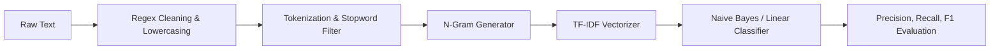

# 📊 NLP Sentiment Classification Pipeline

[](https://www.python.org/)
[]()
[](LICENSE)

An end-to-end **Natural Language Processing (NLP)** pipeline for text preprocessing, n-gram TF-IDF vectorization, and sentiment classification. Built with clean OOP architecture and comprehensive evaluation metrics.

---

## ⚡ Pipeline Architecture



---

## 🚀 Features

- **Text Normalization:** Handles punctuation stripping, contraction expansion, and stopword pruning.
- **Configurable N-Gram Extraction:** Unigram, bigram, and trigram feature extraction.
- **TF-IDF Weighting:** Inverse document frequency scaling with sublinear term frequency.
- **Evaluation Suite:** Generates confusion matrices, accuracy, precision, recall, and F1-scores.

---

## 🛠️ Usage

```python
from nlp.pipeline import SentimentPipeline

pipeline = SentimentPipeline()
pipeline.train([
    ("The product was fantastic and exceeded expectations!", "positive"),
    ("Terrible experience, completely broke on day one.", "negative")
])

pred, confidence = pipeline.predict("Absolutely wonderful service!")
print(f"Sentiment: {pred} (Confidence: {confidence:.2f})")
```

---

## 🧪 Tests

```bash
pytest tests/ -v
```

---

## 📄 License
MIT License.
